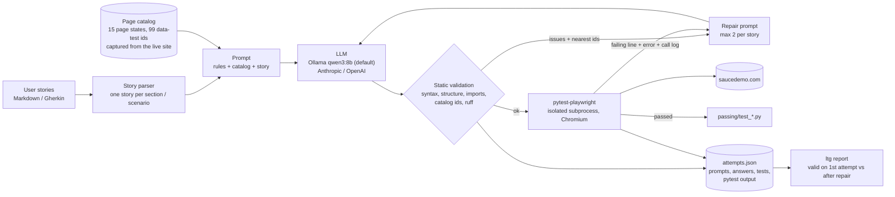

# llm-test-generator

Turns user stories and Gherkin scenarios into Playwright (Python) tests with an LLM, runs every test against the live app, and sends failures back to the model with the real error for up to two repairs, logging each attempt so the results can be measured.

[](https://github.com/Gabnagawo/llm-test-generator/actions/workflows/ci.yml)
[](https://github.com/Gabnagawo/llm-test-generator/actions/workflows/live-replay.yml)

[](LICENSE)

## Why

"Generate tests with an LLM" demos usually stop at code that looks right. Whether
it runs is a different question: models invent selectors, assume URLs, call
methods that do not exist and write assertions that pass vacuously. A useful
generator has to answer two questions with numbers: how many generated tests
pass against the real app on the first try, and how many more a feedback loop
recovers.

This project builds that loop and measures it:

- the model never sees the DOM; it sees a **page catalog** captured from the live
  site with Playwright and committed to the repo, so every run uses the same
  input, and a **static validator** rejects any `data-test` id that is not in it,
  before a browser starts;
- generated code is also checked for structure (one test, the `page` fixture, at
  least one `expect`), an import allowlist, no sleeps or `page.evaluate`, and
  pyflakes-level errors;
- each test runs in **its own pytest subprocess** with an isolated config and
  5-second Playwright timeouts, and the failure is classified (locator timeout,
  strict-mode violation, assertion, Python error, ...);
- the **repair prompt** contains the model's previous answer, the failing line of
  the test and Playwright's error and call log, or the nearest catalog ids for an
  invented selector;
- every prompt, answer, test file and pytest output is stored, and `ltg report`
  turns the attempt logs into the table below.

## How it works



A test counts as **valid** when it passes against the live app. Twelve example
stories in [examples/stories/](examples/stories/) (two Markdown files, two
`.feature` files) cover login, logout, the cart, sorting, the product page and
checkout on [saucedemo.com](https://www.saucedemo.com), a public demo shop.

## Quick start

```bash
git clone https://github.com/Gabnagawo/llm-test-generator && cd llm-test-generator
uv sync && uv run playwright install chromium
uv run ltg run examples/stories --only successful-login --only checkout-requires-a-first-name
```

This needs [Ollama](https://ollama.com) running locally with `ollama pull qwen3:8b`.
For a hosted model, set `LLM_PROVIDER=anthropic` (or `openai` plus `LLM_MODEL`)
and the API key in `.env`, after `uv sync --extra anthropic`; see
[.env.example](.env.example).

> **Generated code runs on your machine, unsandboxed.** `ltg run` executes the Python
> the model writes with your user's privileges. Read
> [Security: generated code is not sandboxed](#security-generated-code-is-not-sandboxed)
> before running stories you did not write.

Windows has no `make`, so every target is also a `uv run` command:

| Task | make | uv |
|---|---|---|
| unit tests + coverage (no browser, no LLM) | `make test` | `uv run pytest` |
| demo: 3 stories | `make demo` | `uv run ltg run examples/stories --only successful-login --only sorting-by-price-from-low-to-high --only checkout-requires-a-first-name` |
| full benchmark: 12 stories | `make bench` | `LLM_SEED=42 uv run ltg run examples/stories` |
| compare runs | `make report` | `uv run ltg report runs/<run-a> runs/<run-b>` |
| replay committed generated tests + catalog drift check | `make e2e` | `uv run pytest -m e2e --no-cov` |
| re-capture the page catalog | `make catalog` | `uv run ltg catalog capture` |
| show the catalog as the LLM sees it | | `uv run ltg catalog show` |
| validate any test file statically | | `uv run ltg check path/to/test_x.py` |

## Example output

Real console output of the benchmark run with `qwen3:8b` (thinking off), unedited
(also in [docs/results/benchmark/qwen3-8b-think-off/console.txt](docs/results/benchmark/qwen3-8b-think-off/console.txt)):

```text
$ LLM_SEED=42 uv run ltg run examples/stories --run-id qwen3-8b-think-off --out runs
llm-test-generator 0.1.0: 12 stories, ollama qwen3:8b, mode=run, max repairs=2, target https://www.saucedemo.com
run folder: runs/qwen3-8b-think-off
[ 1/12] successful-login  #1 generate PASS  (17.7 s LLM, 9.6 s browser)
[ 2/12] locked-out-user-is-rejected  #1 generate PASS  (19.2 s LLM, 3.0 s browser)
[ 3/12] wrong-password-is-rejected  #1 generate PASS  (20.6 s LLM, 2.9 s browser)
[ 4/12] logout-from-the-menu  #1 generate execution_failed assertion_failed: AssertionError: Page URL expected to be 're.compile('.*/login\\.html$')'  (21.0 s LLM, 9.0 s browser)
[ 4/12] logout-from-the-menu  #2 repair   execution_failed assertion_failed: AssertionError: Page URL expected to be 're.compile('.*/login\\.html$')'  (27.1 s LLM, 9.1 s browser)
[ 4/12] logout-from-the-menu  #3 repair   execution_failed assertion_failed: AssertionError: Page URL expected to be 're.compile('.*/login\\.html$')'  (27.9 s LLM, 9.7 s browser)
[ 5/12] adding-a-product-updates-the-cart-badge  #1 generate PASS  (26.1 s LLM, 3.2 s browser)
[ 6/12] removing-a-product-from-the-cart-page-empties-the-cart  #1 generate execution_failed assertion_failed: AssertionError: Locator expected to have count '0'  (29.7 s LLM, 8.6 s browser)
[ 6/12] removing-a-product-from-the-cart-page-empties-the-cart  #2 repair   execution_failed assertion_failed: AssertionError: Locator expected to have count '0'  (34.3 s LLM, 8.2 s browser)
[ 6/12] removing-a-product-from-the-cart-page-empties-the-cart  #3 repair   execution_failed assertion_failed: AssertionError: Locator expected to have count '0'  (36.1 s LLM, 8.4 s browser)
[ 7/12] the-cart-lists-every-product-that-was-added  #1 generate execution_failed assertion_failed: AssertionError: Locator expected to have text 'Sauce Labs Backpack'  (34.0 s LLM, 8.0 s browser)
[ 7/12] the-cart-lists-every-product-that-was-added  #2 repair   execution_failed python_error: TypeError: LocatorAssertions.to_have_text() got an unexpected keyword argument 'exact'  (43.0 s LLM, 3.6 s browser)
[ 7/12] the-cart-lists-every-product-that-was-added  #3 repair   execution_failed assertion_failed: AssertionError: Locator expected to have text 'Sauce Labs Backpack'  (38.5 s LLM, 9.2 s browser)
[ 8/12] sorting-by-price-from-low-to-high  #1 generate PASS  (25.0 s LLM, 3.0 s browser)
[ 9/12] sorting-by-name-from-z-to-a  #1 generate PASS  (23.4 s LLM, 2.7 s browser)
[10/12] opening-a-product-detail-page  #1 generate execution_failed strict_mode_violation: AssertionError: Locator expected to have text 'Sauce Labs Bike Light'  (28.8 s LLM, 3.0 s browser)
[10/12] opening-a-product-detail-page  #2 repair   execution_failed python_error: AttributeError: 'LocatorAssertions' object has no attribute 'first'  (37.2 s LLM, 3.1 s browser)
[10/12] opening-a-product-detail-page  #3 repair   execution_failed python_error: AttributeError: 'LocatorAssertions' object has no attribute 'first'  (35.3 s LLM, 3.1 s browser)
[11/12] complete-a-purchase  #1 generate PASS  (51.4 s LLM, 3.4 s browser)
[12/12] checkout-requires-a-first-name  #1 generate PASS  (29.5 s LLM, 3.3 s browser)

valid on 1st attempt: 8/12 (67 %); after repair 1: 8/12 (67 %); after repair 2: 8/12 (67 %)
LLM calls: 20, median latency 29.2 s, wall time 12.1 min
passing tests: runs/qwen3-8b-think-off/passing/
attempt log:   runs/qwen3-8b-think-off/attempts.json
```

One of the generated tests, unedited (from
[examples/generated/](examples/generated/), which holds every test that passed in
the benchmark runs; CI replays them against the live site):

```python
def test_complete_a_purchase(page: Page) -> None:
    page.goto("/")
    page.get_by_test_id("username").fill("standard_user")
    page.get_by_test_id("password").fill("secret_sauce")
    page.get_by_test_id("login-button").click()
    expect(page).to_have_url(re.compile(r".*/inventory\.html$"))

    page.get_by_test_id("add-to-cart-sauce-labs-backpack").click()
    expect(page).to_have_url(re.compile(r".*/inventory\.html$"))
    expect(page.get_by_test_id("shopping-cart-badge")).to_have_text("1")

    page.get_by_test_id("shopping-cart-link").click()
    expect(page).to_have_url(re.compile(r".*/cart\.html$"))

    page.get_by_test_id("checkout").click()
    expect(page).to_have_url(re.compile(r".*/checkout-step-one\.html$"))

    page.get_by_test_id("firstName").fill("Ada")
    page.get_by_test_id("lastName").fill("Lovelace")
    page.get_by_test_id("postalCode").fill("12345")
    page.get_by_test_id("continue").click()
    expect(page).to_have_url(re.compile(r".*/checkout-step-two\.html$"))

    expect(page.get_by_test_id("subtotal-label")).to_have_text("Item total: $29.99")
    expect(page.get_by_test_id("total-label")).to_have_text("Total: $32.39")

    page.get_by_test_id("finish").click()
    expect(page).to_have_url(re.compile(r".*/checkout-complete\.html$"))

    expect(page.get_by_test_id("complete-header")).to_have_text("Thank you for your order!")
```

## Results

All numbers come from runs made in this repository on 2026-11-12 against the live
saucedemo.com. Raw evidence (attempt logs, every LLM answer, every generated test
and its pytest output) is in [docs/results/benchmark/](docs/results/benchmark/).
Machine: Windows 11, AMD Ryzen 5 4500, 16 GB RAM, Radeon RX 580 (Ollama 0.40.16,
Vulkan), Python 3.12.10, Playwright 1.65.1. Ollama was shared with another
process during the runs. Prompt version `2026-11-12.1`, catalog sha256 `f9e45271cc78`,
seed 42, max 2 repairs.

**Valid tests (passing against the live app), 12 stories:**

| Model | Valid on 1st attempt | After repair 1 | After repair 2 | LLM calls | Median LLM latency | Wall time |
|---|---|---|---|---|---|---|
| Ollama `qwen3:8b`, thinking off | **8/12 (67 %)** | 8/12 (67 %) | **8/12 (67 %)** | 20 | 29.2 s | 12.1 min |
| Ollama `qwen3:8b`, thinking on | to be measured | | | | | |

The thinking-on run was stopped after 1 of 12 stories (it passed, after a 179 s
generation) because the machine ran low on memory; its partial output is in
[partial-qwen3-8b-think-on](docs/results/benchmark/partial-qwen3-8b-think-on/).
qwen3:8b is the only chat model available locally, so this table has one
measured row.

Reproduce one row: `LLM_SEED=42 uv run ltg run examples/stories --run-id <name>`
(add `--think` for thinking mode), then `uv run ltg report runs/<name>`.
The full report is in [docs/results/report.md](docs/results/report.md).

**What failed, and why the repair loop did not help (thinking off).** The four
failures are wrong assumptions about the app, and the model repeated them after
seeing the error:

| Story | Failure | Repairs |
|---|---|---|
| logout-from-the-menu | asserted a `/login.html` URL; the login page is `/` (and the catalog says so) | same assertion twice |
| removing-a-product-from-the-cart-page-empties-the-cart | expected the cart container to disappear (`to_have_count(0)`); only its items do | same assertion twice |
| the-cart-lists-every-product-that-was-added | asserted one exact text on a locator matching two products | tried a non-existent `exact=` argument, then the original |
| opening-a-product-detail-page | strict-mode violation on a repeated id | called `.first()` on the assertion object instead of the locator, twice |

**Other measurements:**

| Metric | Result | Reproduce |
|---|---|---|
| Unit tests | **106 passed** (10 e2e/live tests deselected by default) | `uv run pytest` -> [pytest.txt](docs/results/pytest.txt) |
| Line + branch coverage | **97.70 %** (CI gate: 80 %) | `uv run pytest` |
| Lint / types | ruff check and format clean, mypy `--strict` clean (14 files) | [lint.txt](docs/results/lint.txt) |
| Page catalog | 15 page states, 99 `data-test` ids; re-capture matches the committed ids | `uv run pytest -m e2e -k drifted --no-cov` |
| Committed generated tests re-run on the live site | **8/8 passed** (the tests in `examples/generated/`) | `uv run pytest -m e2e -k generated --no-cov` -> [e2e-replay.txt](docs/results/e2e-replay.txt) |
| Hosted models (Anthropic, OpenAI) | to be measured | `LLM_PROVIDER=anthropic uv run ltg run examples/stories` |

Two earlier full runs were discarded, and their raw output is kept:
[aborted-1-catalog-gap](docs/results/benchmark/aborted-1-catalog-gap/) (the
validator rejected a valid `remove-<product>` id because the first catalog had
captured only one product's remove button; the capture now fills the cart) and
[aborted-2-shared-server-http500](docs/results/benchmark/aborted-2-shared-server-http500/)
(the shared Ollama answered HTTP 500 "token repeat limit reached" to all 12
generations within 2–4 s retries; retries now back off exponentially).

## Limitations

### Security: generated code is not sandboxed

`ltg run` writes the model's answer to a file and runs it with pytest **on the host,
with the privileges of the user who started it**. There is no sandbox.

- **The static validator is not a security boundary.** It is a quality gate: it catches
  invented selectors, sleeps and stray imports before a browser starts. It also rejects
  the obvious ways around its allowlist (dunder access, `getattr`, `pytest.importorskip`,
  `page.request`, navigation to another host), but a static check of Python source cannot
  stop code that is written to get past it. Treat a test that passes validation as
  untrusted code.
- **The model's input is not fully under your control.** The prompt contains the story
  files and text captured from a third-party site (the page catalog). Either can carry
  instructions that steer the model (prompt injection).
- **Recommendation:** run generation in a container or a VM with no credentials, no
  mounted home directory and only the network access the app under test needs. The
  `Dockerfile` in this repository is a starting point (it runs as a non-root user); the
  image has not been built or tested yet. Run on the host only with stories you wrote
  and a target site you trust.
- `ltg check` and the unit tests only parse generated code and never execute it.

### Other limitations

- **One app, twelve stories, one seed per configuration.** These are honest
  numbers for this setup, not a general measure of model quality, and a rerun
  with another seed will move individual stories. The stories were written
  before the runs and were not tuned to the model.
- **Small local model.** `qwen3:8b` (Q4_K_M) is what runs at zero cost here.
  Hosted models are supported but not measured.
- **The catalog is app-specific.** Capturing it for another app means writing a
  new tour in `capture.py`. Elements without a `data-test` id are reachable only
  through `get_by_role` / `get_by_text`, which the validator does not check.
- **Validity means "passes".** A passing test can still under-test a story. The
  validator requires at least one `expect`, but whether every acceptance
  criterion is asserted is checked by reading the tests, not automatically.
- **The live site can change.** saucedemo.com is third-party. The replay of the
  committed tests and the catalog drift check run in a separate scheduled workflow
  (`live-replay.yml`, its own badge), so the CI badge reflects this repository only
  and the live-replay badge can turn red when the demo site changes or is slow.
- The format example in the prompt shows the login pattern (on a story that is
  not in the benchmark), which every story needs; that makes login boilerplate
  easier than it would be zero-shot.
- Dynamic selector strings (f-strings) are not checked against the catalog.

## Roadmap

- Measure hosted models (Claude Sonnet, an OpenAI model) on the same 12 stories, and several seeds per configuration.
- Assertion coverage check: map each acceptance criterion to an `expect` in the generated test.
- Repair prompts that include a fresh catalog snapshot of the page where the test failed (the main cause of the unrecovered failures above).
- A second target app (TodoMVC) to show the catalog capture generalizes.
- Emit the generated suite as a ready-to-run project (conftest, pytest.ini, CI job).

## License

MIT, see [LICENSE](LICENSE). Copyright (c) 2026 Gabriel Nagawo.
